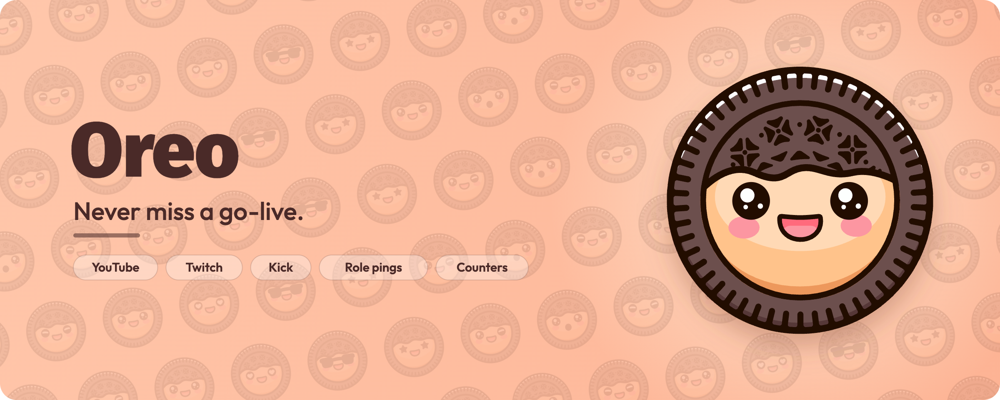

<picture>
  
</picture>

  
  
  

Oreo posts in your Discord server the moment your favourite creators go live or upload on YouTube, Twitch or Kick. You set it up once on the dashboard or with `/settings`, and it does the rest.

### What it does
<table>
  <tr>
    <td width="50%" valign="top"><b>Live and upload alerts</b> Streams and videos from YouTube, Twitch and Kick, posted as soon as they happen.</td>
    <td width="50%" valign="top"><b>Posts that keep up</b> When a stream ends, Oreo edits its post and links the recording. Or it deletes the post instead.</td>
  </tr>
  <tr>
    <td valign="top"><b>Role pings</b> Ping a role for each creator. Members can pick up the role themselves with the Notify me button.</td>
    <td valign="top"><b>Your own messages</b> Write the message and the embed with placeholders. The dashboard shows exactly what will post.</td>
  </tr>
  <tr>
    <td valign="top"><b>Live counters</b> A channel name that shows a subscriber or follower count and keeps itself up to date.</td>
    <td valign="top"><b>Live role</b> Creators get a role while they stream, so they sit at the top of the member list.</td>
  </tr>
</table>

### Get in touch
Questions, bugs and ideas go in our [support server](https://discord.gg/KsWaypC8hH).

<a href="https://discord.gg/KsWaypC8hH">
  <picture>
    <source media="(prefers-color-scheme: dark)" srcset="https://discordwidgets.vercel.app/widgets/invite/KsWaypC8hH?theme=dark" />
    <source media="(prefers-color-scheme: light)" srcset="https://discordwidgets.vercel.app/widgets/invite/KsWaypC8hH?theme=light" />
    
  </picture>
</a>
